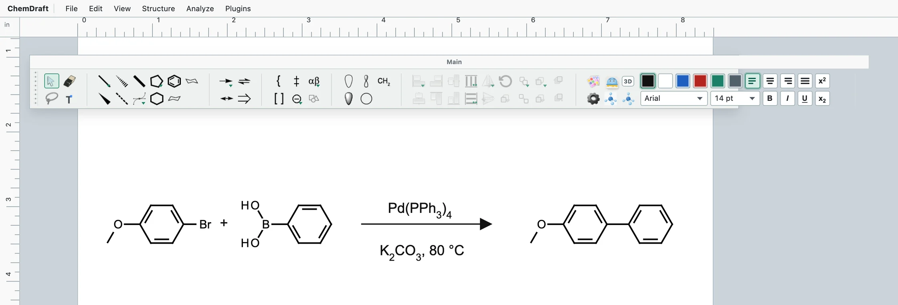

<p align="center">
  
</p>

<h1 align="center">ChemDraft</h1>

<p align="center">
  <b>A free, open-source chemical drawing app for macOS and Windows.</b>
</p>

<p align="center">
  <a href="https://github.com/jgassens/ChemDraft/releases/latest">Download</a> ·
  <a href="https://chemdraft.ai">Website</a> ·
  <a href="#plugins">Plugins</a> ·
  <a href="#use-chemdraft-from-scripts-and-ai-assistants">Agents</a> ·
  <a href="https://github.com/jgassens/ChemDraft/issues">Report a problem</a>
</p>

<p align="center">
  
</p>

ChemDraft is a desktop app for drawing molecules and reactions, checking them, and putting them into
papers, slides, exams and figures. It opens and saves CDXML and CDX, keeps your documents as ordinary
files on your own computer, and needs no account. New chemistry goes into plugins, so the core app
stays small. This README describes ChemDraft 1.2.2.

## Download

Every release ships three builds from the same commit and version number:

| Platform | Package | Notes |
|---|---|---|
| macOS, Apple silicon | `.dmg` | Signed and notarized by Apple. Updates are offered inside the app. |
| macOS, Intel | `.dmg` | macOS 11 or later. Signed and notarized. Updates inside the app. |
| Windows x64 | setup `.exe` installer | Installs for the current user. Not code-signed yet, so SmartScreen may warn once: choose "More info", then "Run anyway". Updates inside the app. |

Get them from the [latest release](https://github.com/jgassens/ChemDraft/releases/latest), or from
[chemdraft.ai](https://chemdraft.ai), which links to the same files. Older builds and notes are on the
[releases page](https://github.com/jgassens/ChemDraft/releases).

**Linux (beta).** Linux is a separate, community-tested beta stream with its own release tags. It
offers a `.deb` (Ubuntu 22.04+, Linux Mint 21+, Debian 12+ and relatives) and an x86-64 AppImage
(glibc 2.35 or later). How it differs from the macOS and Windows builds:

- macOS and Windows releases never wait for Linux, so the Linux beta may lag behind.
- There is no built-in updater on Linux yet; download new versions by hand.
- It leaves beta once it passes testing on real desktops (GNOME, KDE and Cinnamon, on X11 and
  Wayland) and has its own update system. See the [roadmap](ROADMAP.md#linux) and
  [docs/releasing/linux.md](docs/releasing/linux.md).

## What ChemDraft does

**Draw**

- Molecules, reactions and mechanisms: bonds, rings, wedges, wavy bonds for unknown stereochemistry,
  atom labels and abbreviations, charges, radicals and lone pairs, brackets and repeat units.
- Reaction arrows with formatted conditions, mechanism arrows, text, shapes, editable tables,
  pictures and structure templates.
- Paste a SMILES string or a molfile and get an editable structure.
- Drawing style presets: ChemDraft Synthetic, Document style, ACS 1996-style, RSC journal-style
  and a hand-drawn Sketch style. See the
  [preset values and sources](packages/chem-core/README.md#native-drawing-presets).
- New to the app? **Help ▸ Take the Tour**.

**Check**

- The Molecular Inspector computes about sixty properties offline with RDKit, including formula,
  average and exact mass, InChI and InChIKey, logP and TPSA, plus estimated pKa.
- Isotope patterns and common adduct m/z values for mass spectrometry.
- Search a selected structure in PubChem or Reaxys through your browser, with consent on first use
  for each site. Turn it off under Preferences ▸ Online structure search.

**See it in 3D**

- **Spin 3D** builds a 3D conformer with RDKit, lets you turn it with the mouse, and lays the view
  you choose back onto the page. It warns or refuses when flattening would change stereochemistry.
- **Interactive 3D Workspace** (Structure menu) is experimental. It is backed by a bundled native
  engine running Avogadro's UFF force field.

**Files and sharing**

- Open and save ChemDraft documents, CDXML and binary CDX.
- Export SVG, PDF, PNG, JPEG, TIFF, GIF, BMP, CDXML, CDX, SDF and SMILES. To get a molfile, use **Edit ▸ Copy As ▸ MOL Text**.
- Copy tables into Word, Excel or PowerPoint as real tables. There is no Office add-in in 1.2.2.

**About CDXML and CDX compatibility.** We claim only what our test fixtures cover. Atoms, bonds,
coordinates, charges, isotopes, radicals, wedges, E/Z geometry, superatoms, basic R-groups, text,
simple arrows, plus signs, basic brackets and styles are supported. More advanced chemistry
(R-group logic, S-groups, polymers, atom lists, mapping, some arrow types) works only where fixtures
exist. Complex graphics, embedded images, unusual fonts and proprietary style state are preserved or
approximated at best. When something can't be represented, ChemDraft keeps it or warns you; it does
not drop it silently. Each release's notes list the current known limitations.

## Plugins

Plugins add capabilities without growing the core app. Install the official ones from
**Plugins ▸ Add or Remove Plugins…**. Each lives in its own repository, declares what it is allowed
to touch, and updates only from its own GitHub releases, checked against a SHA-256 checksum.

- **Name to Structure (OPSIN).** Type a systematic name and insert its structure. If OPSIN doesn't
  recognize a name, an offline dictionary of common names, trade names and CAS registry numbers is
  tried.
- **Name from Structure (Orthonym).** Names the selected structure. Every name shown was read back
  by OPSIN as exactly the drawn structure. Installing it downloads a local naming engine (about
  100 MB).
- **NMR Shift Predictor.** ¹H and ¹³C shift estimates from an OpenChemLib-native HOSE-fragment
  lookup over statistics derived from NMRShiftDB2 assignments. ¹H multiplicities and coupling
  constants are first-order estimates and are labeled as such. An environment with no match gets
  no invented shift, and partial results carry warnings. The predictor's database carries
  NMRShiftDB2's ODbL-derived terms, which are separate from the plugin's code license.
- **Structure from Image (MolScribe). Experimental.** Recognizes a drawn structure from an image or
  screenshot. It works best on clean, computer-drawn structures; hand-drawn, sketch-style or
  color-filled drawings and images with grid lines are often misread. You review every result
  before it is inserted. Installing it downloads a local recognition engine (about 2.5 GB), and
  recognition runs on your computer.

**AI assistant.** ChemDraft 1.2.2 contains the host side of an in-app assistant: a plugin can run a
local Claude Code or Codex session that reads your document and places results on the page through
ChemDraft's own tools, with one undo step per request. The assistant plugin itself is developed and
distributed separately; it is not part of this open-source repository and is not in the built-in
plugin list.

**Vibe code your own plugin.** **Plugins ▸ Vibe Code Your Own Plugin…** saves a starter brief you
hand to a coding assistant. It explains the plugin interface and walks the assistant through
building, packaging and testing. Install the result with **Plugins ▸ Add or Remove Plugins… ▸ Add
plugin from package…**, and only install plugins you trust. The full guide is
[docs/plugin-architecture/AUTHORING.md](docs/plugin-architecture/AUTHORING.md), and
[`examples/plugins/mass-fragment-demo`](examples/plugins/mass-fragment-demo) is a complete working
example.

## Use ChemDraft from scripts and AI assistants

These three surfaces run from a copy of the source code, not from the downloaded app. They need
Git, Node 24 and pnpm 10.12.1 on macOS or Windows, plus a JDK for name-to-structure. They all call
the same document code as the desktop app, so a drawing made by an assistant matches the one on the
canvas. Setup for each is in [skills/chemdraft/references/setup.md](skills/chemdraft/references/setup.md).

**Headless CLI** ([packages/chemdraft-cli](packages/chemdraft-cli/README.md)). Render, build
documents, draw grids and reactions, analyze, convert names, check stereochemistry, predict NMR and
export, without opening a window. Results are JSON Lines on stdout. Always use `pnpm -s` so stdout
stays clean:

```sh
pnpm -s chemdraft render --smiles 'CCO' --out ethanol.svg
```

**MCP server** ([packages/chemdraft-mcp](packages/chemdraft-mcp/README.md)). A local stdio MCP
server that exposes the same operations as typed tools to Claude Code, Claude Desktop and other MCP
clients. To register it with Claude Code:

```sh
claude mcp add chemdraft -- pnpm -s --dir "<checkout>" chemdraft-mcp
```

**Agent Skill** ([skills/chemdraft](skills/chemdraft/SKILL.md)). One skill folder in the open Agent
Skills format. It teaches an assistant to use ChemDraft's tools instead of drawing molecules by
hand or quoting chemistry numbers from memory. On macOS, link it into Claude Code:

```sh
mkdir -p "$HOME/.claude/skills"
ln -s "<checkout>/skills/chemdraft" "$HOME/.claude/skills/chemdraft"
```

## Building from source

You need Git, Node 24, pnpm 10.12.1 and Rust (the toolchain is pinned in
[rust-toolchain.toml](rust-toolchain.toml)), plus a JDK to build the bundled OPSIN runtime. Then:

```sh
pnpm install
node scripts/build-opsin-runtime.mjs   # once per machine; never copy it between platforms
```

- **macOS:** `./run-app` builds and launches the packaged app (Apple silicon);
  `./run-app -t x86_64-apple-darwin` builds the Intel app; `./run-app --dev` runs with hot reload.
- **Windows:** `pnpm dev`, or `pnpm --filter @chemdraft/desktop build --bundles nsis` for an
  installer.

Builds from a branch other than `main` run as a separate app, "ChemDraft (dev)", so they never
replace an installed ChemDraft.
Before sending a change, run the same checks as CI:

```sh
pnpm lint
pnpm vitest run
node --test "scripts/*.test.mjs" "tools/release/*.test.mjs"
pnpm build
git diff --check
cargo fmt --manifest-path apps/desktop/src-tauri/Cargo.toml --check
cargo clippy --all-targets --manifest-path apps/desktop/src-tauri/Cargo.toml -- -D warnings
cargo test --manifest-path apps/desktop/src-tauri/Cargo.toml
```

[AGENTS.md](AGENTS.md) has the full development rules, platform notes and verification guidance.
Release builds are documented in [docs/releasing/](docs/releasing/three-builds.md).

## Contributing

Bug reports, feature requests and pull requests are all welcome.

- In the app, **Help ▸ Report a Bug…** starts a report for you. Or open a
  [GitHub issue](https://github.com/jgassens/ChemDraft/issues) with the app version, your operating
  system and the steps that reproduce the problem.
- Code changes go in through pull requests. Every change has to work on macOS Apple silicon, macOS
  Intel and Windows, and CI must pass on all of its hosts before it merges. Read
  [AGENTS.md](AGENTS.md) first; it applies to human contributors and AI coding assistants alike.
- Upcoming work is on the [roadmap](ROADMAP.md).

If ChemDraft helps your work, you can [support its development](https://buymeacoffee.com/gassensmith).

## License

- The ChemDraft core is licensed under [Apache-2.0](LICENSE).
- The plugin SDK packages ([`@chemdraft/plugin-api`](packages/plugin-api) and
  [`@chemdraft/plugin-host`](packages/plugin-host)) and the example plugins in
  [`examples/plugins`](examples/plugins) are MIT.
- [NOTICE](NOTICE) ships with every distribution and lists attribution and third-party notices.
- Official plugins live in their own repositories under their own licenses. Code and data licenses
  are separate: the NMR predictor's database carries NMRShiftDB2's ODbL-derived terms.
